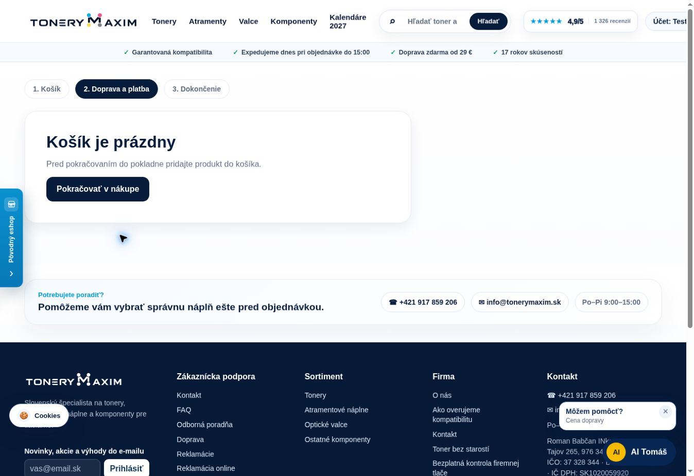
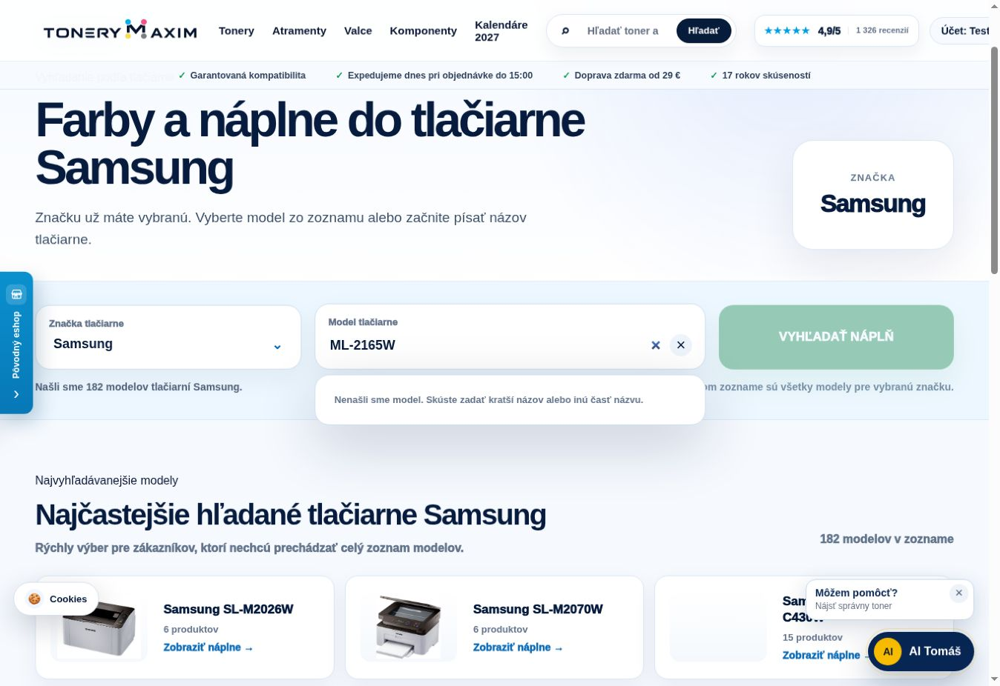

# Živé overenie ToneryMaxim – 15. 10. 2026

Nasadené pamäťové a AI opravy fungujú v kontrolovaných scenároch. Audit však odhalil dve ďalšie funkčné chyby: orezaný košík v desktopovej hlavičke a stratenú koncovku modelu v samostatnom výbere tlačiarne. Výsledok preto nie je „všetko bez chyby“.

## Rozsah a funkčné výsledky

Hlavný HTTP beh: 2026-10-15T06:29:24.338Z až 2026-10-15T06:35:18.783Z (UTC), 754 požiadaviek. Nasledovali doplnkové API kontroly, deväť modelových scenárov a ručné overenie rozhrania. GitHub main je a1fc76b; aplikácia verejne nevracia presný commit, preto ho kryptograficky nepotvrdzujeme. Prítomnosť novej diagnostiky a opravené správanie na produkcii boli potvrdené.

| Kontrola | Výsledok |
| --- | --- |
| 300 odlišných OEM naprieč 10 značkami; klasické vyhľadávanie aj našeptávač | 600 úspešných kontrol |
| CF53 | 14 produktov; kompatibilná sada je prvá v oboch vyhľadávačoch |
| AI Tomáš | 15 scenárov, 17 meraní vrátane 2 opakovaní; 0 odpovedí nad 10 s |
| Produktové detaily | 36/36 dostupných stránok; list a produktové API majú zhodné kladné ceny |
| Unikátne obrázkové URL | 34/34 HTTP 200 a obrazový content-type |
| Serverové chyby v hlavnom behu | 0 odpovedí 5xx |
| Prázdny košík – order-create aj gopay-create | správne HTTP 400 bez objednávky/platby |

Lexmark 56F2X0E má v API aj AI 20 000 strán a 11 tlačiarní. Canon CRG-054 CMYK stojí 75,20 €. Epson 102 pre ET-2700 sa našiel. Neurčité „30X do HP, neviem model“ vyžiadalo spresnenie. Výklad obsahuje toner, valec aj odpadovú nádobu. Xerox 700 neponúkol valec ako toner a samostatný OEM valca ostal dostupný. Zakázané varianty sa v kontrolovaných AI odpovediach neobjavili.

Počas review sa opravili tri chyby meracieho skriptu, nie webu: Commerce vracia pole type; Smart Search vracia title; Brother TN-1050 môže mať regionálny originál TN-1030 pre rovnaké overené tlačiarne. Obe ovplyvnené AI otázky sa zopakovali úspešne a CF53 bol overený cez API aj prehliadač. Pôvodné neúspešné assertions zostali v priložených dátach. Brother pre TN-1030 uvádza DCP-1610WE: https://store.brother.cz/supplies/laser/toner/tn/tn1030.

## Živá pamäť

| Fáza | RSS | Heap | Cgroup |
| --- | ---: | ---: | ---: |
| Začiatok hlavného behu | 264 MB | 134 MB | 227 MB |
| Najvyššia zachytená vzorka hlavného behu | 334 MB | 212 MB | 300 MB |
| Po dokončení a prirodzenom uvoľnení | 261 MB | 135 MB | 227 MB |
| Po rozšírených kontrolách modelov a obrázkov | 294 MB | 139 MB | 259 MB |

Počas záťaže pamäť stúpla a následne sa prirodzene uvoľnila. Ďalšie návštevy značiek zahriali ďalšie indexy tlačiarní. Všetky vzorky patrili rovnakému PID a uptime rástol; test nevynucoval GC ani reštart. Produktová API cache v hlavnom behu dosiahla najviac 100 položiek a 993824 bajtov, pod 8 MB rozpočtom.

Katalóg má 7 933 produktov, generáciu 15. 10. 2026 o 7:06:56 slovenského času. Tento import prebehol pred štartom aktuálneho procesu; lastSync je null. Špičku ranného importu novej verzie preto tento živý test nepotvrdzuje. Krátky beh nevylučuje dlhodobý leak. memoryLimitConfigured je naďalej false; nastavenie skutočného limitu patrí do Coolify.

## Odozvy

| Meranie | Medián | p95 | Maximum |
| --- | ---: | ---: | ---: |
| Homepage, 6 HTTP meraní | 226.6 ms | 393.2 ms | 393.2 ms |
| Klasické vyhľadávanie, 300 OEM | 403.2 ms | 641.6 ms | 6457.9 ms |
| Našeptávač, 300 OEM | 193.7 ms | 338.7 ms | 7641.4 ms |
| AI, všetkých 17 HTTP meraní | 623.1 ms | 5938.2 ms | 5938.2 ms |

Maximum sa nezamlčuje: niekoľko požiadaviek malo vzdialenú odozvu 5–8 sekúnd. Napríklad našeptávač Brother TN-2220 trval 7 641 ms, ale Server-Timing aplikácie bol 15 ms. Doplnkový curl healthcheck nameral TLS 4,535 s, celkom 5,324 s a aplikačné spracovanie 0,2 ms. Je to preukázané oneskorenie mimo meranej časti aplikácie; z týchto údajov nemožno určiť presné miesto sieťového problému medzi meracím prostredím, cestou a TLS/proxy serverom.

Aplikačné p95 všetkých klasických vyhľadávaní bolo 302.1 ms a našeptávača 16.2 ms. HTTP odozvy nie sú mobilný LCP. Google PageSpeed API vrátilo 429 – vyčerpanú kvótu; nový Lighthouse výsledok preto neuvádzam. Produkčný studený štart sa nevynucoval.

## Košík, pokladňa a AI rozhranie

Prehliadač potvrdil cyklus prázdny → 3 sady → 4 sady → prázdny košík. Pri troch sadách je cena po množstevnej zľave 203,04 €, pri štyroch 225,60 €. Relácia mala už existujúci 7% kupón, preto jej konečný súčet za štyri sady bol 209,81 €. Dobierka ho zvýšila na 211,01 €, prevod a GoPay sa vrátili na 209,81 €. Prepínanie DPD/GLS sprístupnilo správny výber výdajného miesta. Samotná mapa a výber adresy neboli dokončené.

Prázdna pokladňa zobrazuje iba prázdny stav; formulár, sprievodca aj mobilné objednávkové tlačidlo majú hidden a display:none. Potvrdil to cookie-free HTTP obsah aj prehliadač pred pridaním a po odstránení nášho produktu. Existujúce prihlásenie ani kupón sa neodstraňovali. AI v rozhraní zobrazila správnu sadu a obe sumy. Zo sledovaných chýb konzoly pochádzali chyby iba z rozšírenia prehliadača; pre doménu webu sa v posledných 200 zachytených chybách nenašla žiadna.

Skutočné objednávky: 0. GoPay platby: 0. E-maily zákazníkom: 0. Zúčtovanie reálnej GoPay platby sa týmto testom nepotvrdzuje.

## Otvorené funkčné chyby a návrh opravy

1. Pri desktopovej šírke 1 348 px má prihlásená relácia ikonu košíka na x=1 379 až 1 405 px, mimo viditeľného priestoru. Horizontálne orezanie dokumentu ju skryje. Oprava má upraviť rozloženie hlavičky tak, aby priestor pre účet a košík zostal rezervovaný a ostatné časti sa zmenšili alebo zalomili bez odstránenia navigácie.
2. Na stránke Samsung vo výbere podľa tlačiarne vstup ML-2165W zobrazí „Nenašli sme model“ a nechá vyhľadávacie tlačidlo neaktívne. ML-2165 zobrazí jeden model a tri produkty. Hlavný našeptávač Samsung ML-2165W aj priama stránka W-modelu fungujú. Príčina je v zoskupovaní variantov: index si nechá kratší názov a API aj klient potom filtrujú iba tento názov. Oprava má pri skupine zachovať overené aliasy modelov a vyhľadávať ich v API aj v prehliadači; nesmie všeobecne odrezávať koncovky z neoverených sérií.

Ďalšie výhrady: placeholdery Lexmark 56F2X0E, Canon CRG-045BK a Kyocera TK-3160; nenastavený limit v Coolify; nezachytený import nového procesu. Číselné údaje, pôvodné assertions a dodatočné overenia sú v live-release-2026-10-15.json.
