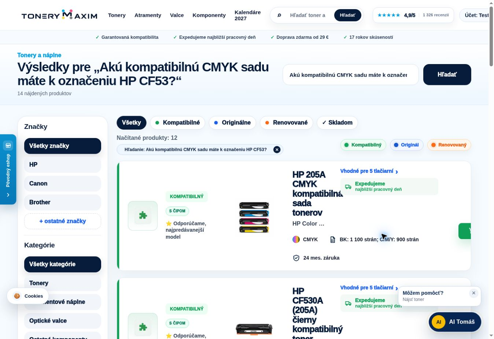

# Overenie živého webu TONERYMAXIM — 13. 10. 2026

Overená verzia: `d4966875b1c8d46bb239eaa0144f3901ef2cb16c`.
Doména: https://www.tonerymaxim.sk (overený aj redirect z tonerymaxim.sk).
Čas: 19:28:59–19:52:04 Europe/Bratislava; približne 23.1 minút.

## Výsledok

- Zachovaných všetkých 7 932 produktov; generácia katalógu
  `2026-10-13T05:07:09.499Z`.
- 300 odlišných tonerových označení v 10 značkách: 300 správnych výsledkov,
  0 zlyhaní. Kontrolovala sa prítomnosť očakávaného ID. Nie je to rebríček predaja.
- Ďalších 162 GET kontrol: produkty, našeptávač, tlačiarne, neznáme značky,
  negatívny dotaz, HTML stránky, oba hosty, šesť úplných detailov, súbežné
  načítanie stránky počas vyhľadávania. Všetky úspešné.
- 40 rôznych neznámych značiek nezvýšilo počet indexov tlačiarní (0 → 0).
  Po použití HP/Canon/Brother/Epson sú štyri podporované indexy.
- Šesť detailov vrátilo celý HTML popis a deväť atribútov; bez straty kompatibility.
- V prehliadači: CF53 → 14 produktov, kompatibilná CMYK sada prvá v návrhoch
  aj výsledkoch; načítané obrázky a popisy; pridanie do prázdneho košíka,
  množstvo 2 a zľava 10 %, rovnaký súčet v pokladni, doprava a platby.
  Testovaný produkt sa odstránil a košík sa vrátil do pôvodného prázdneho stavu.
  Existujúci kupón a údaje testovacieho účtu sa nemenili. Objednávka ani platba
  sa neuskutočnila.
- AI Tomáš odporučil správnu kompatibilnú sadu HP 205A za 73,93 €.
  Odkaz z odpovede otvoril výsledky so správnou sadou na prvom mieste.

## Rýchlosť

Čas aplikácie pochádza z `Server-Timing: app;dur=...`; celý čas odpovede
zahŕňa aj sieť. Výber 19 prvých nezacachovaných pozitívnych produktových
odpovedí sa zostavil z prvého výskytu každej URL naprieč živými kontrolami,
nie z opakovaných cache hitov.

| Meranie | Výsledok |
|---|---:|
| Nové produktové vyhľadávanie: medián spracovania v aplikácii | 224.8 ms |
| Nové produktové vyhľadávanie: najpomalšie spracovanie v aplikácii | 469.6 ms |
| Nové produktové vyhľadávanie: medián celej odpovede | 580 ms |
| Nové produktové vyhľadávanie: najpomalšia celá odpoveď vo výbere | 1159 ms |
| Úvodná stránka počas piatich nových modelových vyhľadávaní | 511–579 ms |

Párové meranie použilo tri vopred otvorené HTTPS spojenia; prvá trojica
health požiadaviek trvala 5,1–5,3 s, druhá 0,20–0,24 s pri spracovaní
health 0,1–0,2 ms. Jedno detailné meranie curl zaznamenalo 4,44 s v TLS fáze
pri čase aplikácie 0,8 ms. Čas nového HTTPS spojenia z tohto vzdialeného
prostredia preto nemožno zamieňať s časom aplikácie alebo s výsledkom
zákazníka na Slovensku. Bez www pridáva canonical redirect druhé spojenie;
meranie štyroch takých URL malo 10,5–11,5 s celkom a 0,2–2,3 ms aplikácie.
Ide o HTTP odpovede, nie meranie LCP ani Lighthouse.

## Pamäť

Všetky vzorky mali ten istý PID a rastúci uptime. Meranie nevynútilo GC,
reštart ani synchronizáciu katalógu. Maximom je najvyššia odobratá vzorka,
nie nepretržite sledované maximum procesu.

| Meranie | Začiatok | Najvyššia vzorka | Koniec |
|---|---:|---:|---:|
| RSS procesu | 207 MB | 269 MB | 259 MB |
| Heap použitý | 100 MB | — | 112 MB |
| Cgroup pamäť | 182 MB | — | 234 MB |

RSS sa počas skúšky samo znížilo z 269 na 206 MB, neskôr aj na 202 MB,
bez reštartu. Na konci: 53 detailov (limit 64), 100 produktových API výsledkov
(limit konfigurácie 100), štyri indexy tlačiarní, štyri negatívne printer zhody
(limit 512). Skúška nezachytila nepretržitý rast, ale 23 minút nie je dôkazom
neprítomnosti dlhodobého úniku. Po nasadení neprebehol denný Woo import;
produkčnú importnú špičku treba ešte zmerať pri najbližšej synchronizácii.

Strojový súhrn: [live-storefront-2026-10-13.json](live-storefront-2026-10-13.json).
Predbežné pozitívne očakávanie MC-G02 sa nepoužilo, pretože tento produkt
v aktuálnom katalógu nie je; nahradil ho overený Xerox B205. Široký Canon MF
vracia aj skupiny/značky, preto sa pri našeptávači overovali všetky typy návrhov.
Nešlo o zásah do produkčného kódu.

