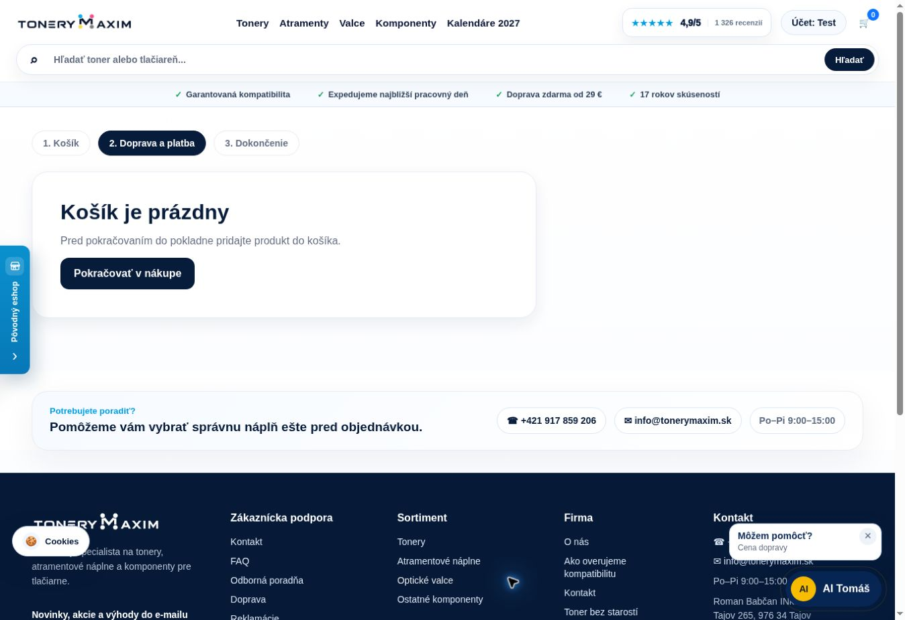
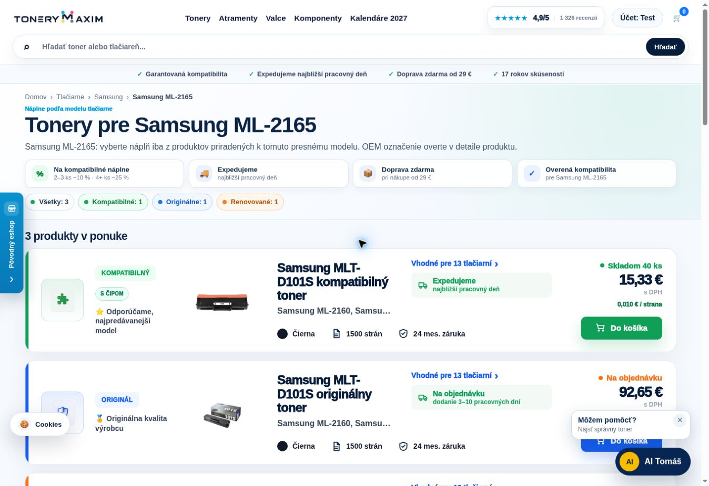

# Živé overenie stability po redeployi – 15. 10. 2026

Používateľ potvrdil redeploy. Vetva `main` pri kontrole ukazovala na `c2bb9a7ef208df95d67b1eb0a14ebf7efa35256a`. Overené boli verejné API a skutočné rozhranie `https://www.tonerymaxim.sk`. Tento report nemení produkčný kód ani nastavenia Coolify.

## Výsledky

| Kontrola | Výsledok |
| --- | --- |
| Kritický verejný test krátko po redeployi | 12/12 prešlo, 16:06–16:07 CEST |
| Rovnaký test večer | 12/12 prešlo, 19:14 CEST |
| OEM vyhľadávanie na živom `/api/products` | 300/300 prípadov; 0 zlyhaní |
| Prázdna pokladňa v prehliadači | Prázdny stav, skrytý formulár aj objednávacie tlačidlo |
| Košík v hlavičke pri šírke kontajnera 1348 px | Viditeľný; pravý okraj ikony 1315 px, miesto zostáva aj pre odznak |
| Samsung ML-2165W v skutočnom výbere | Ponuka W variantu, klik otvorí spoločnú stránku ML-2165 s 3 produktmi MLT-D101S |
| AI cena Canon CRG-045 CMYK | Správne ID 52830, cena sady 75,20 €, 3 ks 203,04 € a 4 ks 225,60 € |
| AI Epson 102 pre ET-2700 | Ponúknuté jednotlivé farby aj CMYK sada rodiny 102 |
| AI neúplné „30X do HP, neviem model“ | Vyžiada model/úplný OEM; akcia CLARIFY_PRINTER |
| AI vysvetlenie toner/valec/odpadová nádoba | Vysvetlené všetky tri diely |
| Lexmark 56F2X0E | Kapacita 20 000 strán a 11 priradených tlačiarní v produktovom API |
| GitHub Live stability | Potvrdený úspešný plánovaný beh vrátane všetkých 12 kontrol a uloženia reportu |

Vyhľadávací test kontroloval prítomnosť očakávaného produktu pri 300 OEM dopytoch na živé produktové API. Nejde o 1111 lokálnych kontrol z predchádzajúceho reportu. Priebežne pracovali najviac tri vyhľadávacie požiadavky súčasne.

Objednávkové endpointy dostali výhradne prázdny košík bez súhlasu a správne vrátili 400. AI otázky nemenili košík. Tento audit nevytvoril objednávku, platbu ani e-mail. Prehliadač zachoval existujúce testovacie prihlásenie; anonymné API požiadavky neposielali cookies. Pri UI kontrole sa nemenili údaje účtu ani obsah košíka.

## Pamäť po viac ako troch hodinách

| Meranie | RSS | Heap | Cgroup | Uptime |
| --- | ---: | ---: | ---: | ---: |
| 16:06 CEST, krátko po redeployi | 225 MiB | 123 MiB | 201 MiB | 275 s |
| 19:14 CEST | 263 MiB | 134 MiB | 239 MiB | 11 544 s |

Rozdiel RSS je +38 MiB, heap +11 MiB. PID je v oboch vzorkách 20 a postup uptime zodpovedá uplynutému času, bez známky reštartu medzi týmito meraniami. Medzitým prebehlo vyhľadávanie a zahrievanie indexov/cache. Dva body nepreukazujú neprítomnosť leaku ani nepriraďujú celý rozdiel konkrétnym objektom.

Katalóg má 7933 produktov, generáciu `2026-10-15T05:06:56.845Z`. `lastSync` je null, pretože táto generácia vznikla pred štartom nového procesu. Najbližší skutočný ranný import po tomto redeployi ešte nebol pozorovaný.

`memoryLimitConfigured` zostáva false. Podľa dohody s používateľom sa tvrdý limit zatiaľ necháva na 0, kým sa overí import a obnova služby. To je otvorená prevádzková úloha, nie údaj, že tento commit nastavil limit.

## Odpovede a prvé spojenie

Večerný kritický test po prvom spojení nameral celé HTTP odpovede približne 182–534 ms. Prvý health request tej istej testovacej relácie trval 7062 ms, pričom server uviedol aplikačné spracovanie 0,1 ms.

Samostatný curl na `/api/health` potvrdil prvé TLS nadviazanie 4,672 s a celú odpoveď 5,114 s. Ďalšie požiadavky na opätovne použitom spojení trvali 0,408 s a 0,183 s. Táto okolnosť sa nesmie zamieňať s pomalým AI výpočtom alebo pripísať výlučne samotnej aplikácii. Presné miesto zdržania medzi testovacím prostredím, sieťou a TLS/proxy sa týmto meraním neurčilo. Výsledok negarantuje každú prvú návštevu pod dve sekundy a nepredstavuje nový Lighthouse test.

## Plánovaný monitoring a zostávajúce nastavenia

GitHub API aj verejné rozhranie ukázali workflow `Live stability` ako aktívny a beh [38749473243](https://github.com/maximtonery-a11y/tonerymaxim/actions/runs/38749473243) s udalosťou `schedule`, stavom `success` a spustením 16:13:26 CEST. Log potvrdil všetkých 12 kontrol aj upozornenie na chýbajúci limit pamäte. Report sa úspešne uložil ako artifact.

Tým je potvrdené skutočné plánované vykonanie; tento report nesľubuje presný čas každého ďalšieho behu. Doručovanie upozornení konkrétnemu príjemcovi sa neoverilo. Nastavenia reštartu po páde, persistentné mounty a obnova zo zálohy vyžadujú kontrolu v Coolify, ku ktorému nie je administračné pripojenie.

Používateľ postupne posiela obrazovky konfigurácie. General ukazuje Nixpacks a prázdne vlastné príkazy. Nixpacks odvodzuje build/start z package.json; navrhnuté explicitné Build Command je `npm run build`, aby bolo jasné spúšťanie prebuild ochrany. Nasleduje kontrola Advanced, storage a upozornení pred prípadným ďalším spoločným redeployom konfigurácie.

## Dôkazy

- [Prvý kritický test](postdeploy-stability-2026-10-15/critical-start.json)
- [Večerný kritický test](postdeploy-stability-2026-10-15/critical-evening.json)
- [300 živých OEM dopytov](postdeploy-stability-2026-10-15/search-300.json)
- [Ďalšie AI a produktové kontroly](postdeploy-stability-2026-10-15/ai-extra.json)
- [Plánovaný GitHub beh a riadky jeho logu](postdeploy-stability-2026-10-15/monitoring.json)
