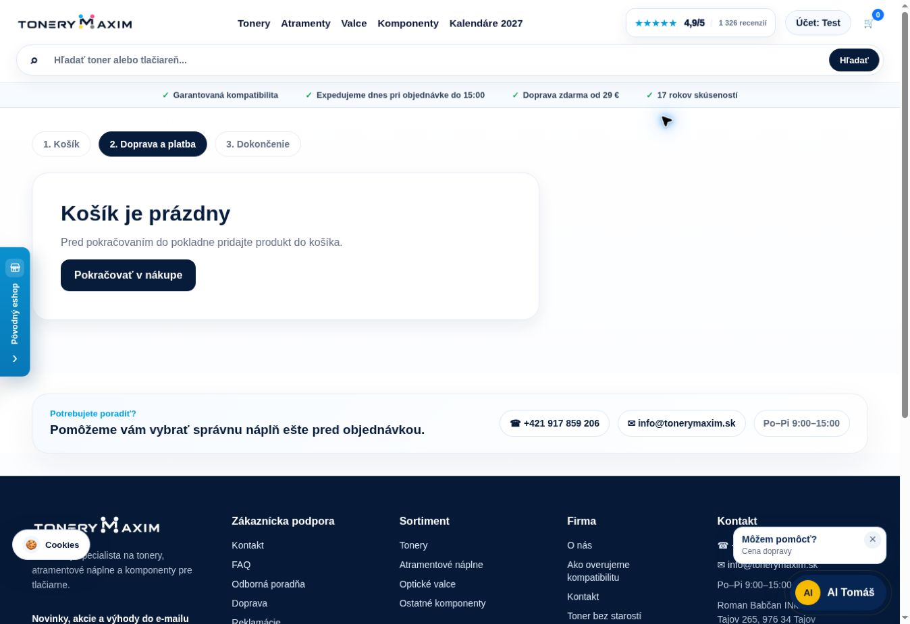
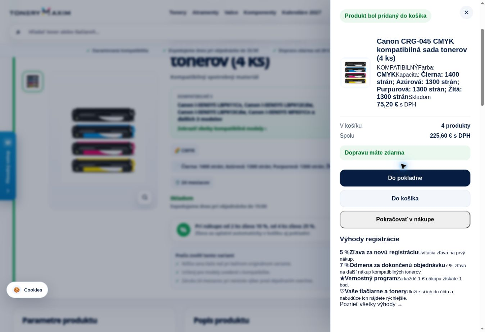

# Živé testy po redeployi – 16. 10. 2026

Používateľ potvrdil dokončenie redeployu. Overenie verejných API a skutočného rozhrania prebehlo približne 07:43–07:54 CEST. GitHub `main` pri začiatku ukazoval na `c2bb9a7ef208df95d67b1eb0a14ebf7efa35256a`. Samotné verejné health API neoznamuje hash buildu; príkaz buildu ani nastavenie reštartov nemožno nezávisle potvrdiť bez administračných alebo deployment logov Coolify.

Výsledok: obidva kritické behy prešli, 300 OEM vyhľadávaní prešlo a fungovali kontrolované nákupné kroky. Pamäť sa počas behu uvoľnila bez reštartu. Zostávajú obsahový nedostatok jednej odpovede AI a placeholder obrázka Lexmark. Tento krátky test nepotvrdzuje neprítomnosť dlhodobého leaku ani pamäťovú špičku nasledujúceho importu.

## Funkčné výsledky

| Kontrola | Výsledok |
| --- | --- |
| Kritický test na začiatku | 12/12 prešlo |
| Opakovaný kritický test po záťaži | 12/12 prešlo |
| Živé OEM vyhľadávanie | 300/300; žiadne zlyhanie |
| CF53 v našeptávači aj po Enter | Funkčné; kompatibilná CMYK sada prvá, klasické vyhľadávanie 14 výsledkov |
| Výber Samsung ML2165W | Ponúkne Samsung ML-2165W; klik otvorí kanonickú stránku ML-2165 s 3 produktmi MLT-D101S |
| Prázdna pokladňa | Prázdny stav, skrytý formulár aj objednávkové tlačidlo; overené API/HTML aj prehliadačom pred testom a po uprataní košíka |
| Prázdne objednávkové API | `/api/order-create` a `/api/gopay-create` správne vracajú 400 |
| Canon CRG-045 CMYK | ID 52830, cena 75,20 €; 4 ks po množstevnej zľave 225,60 €, 3 ks pred ďalším kupónom 203,04 € |
| Canon CRG-054 CMYK po rannom importe | ID 52837, cena 75,20 €; žiadna nulová cena v skontrolovaných 28 výsledkoch rodiny |
| Košík a pokladňa s tovarom | Pridanie 4 sád, zmena na 3 a otvorenie pokladne funkčné; skúšobná položka následne odstránená |
| Lexmark 56F2X0E | ID 53282: kapacita 20 000 strán a 11 tlačiarní; obrázok stále placeholder |
| AI chybné skrátené označenie | Vyžiada presný model/úplný OEM, potvrdené aj v chate prehliadača |
| Hlavička na desktope | Pri šírke obsahu 1348 px je košík celý viditeľný, pravý okraj 1315 px; bez vodorovného pretekania |
| Chýbajúca URL | Správne 404 |

Vyhľadávací manifest obsahuje 10 značiek: Brother, Canon, Epson, HP, Kyocera, Lexmark, OKI, Ricoh, Samsung a Xerox. Tento živý beh overuje očakávané ID v 300 odpovediach produktového API; nie je to 300 testov našepkávača ani 1111 lokálnych kontrol. Bežali najviac tri vyhľadávania súčasne.

Medián celých HTTP odpovedí vyhľadávania bol **632 ms**, 95. percentil **944 ms**, maximum **6792 ms**. Štyri požiadavky prekročili dve sekundy, žiadna desať sekúnd. Ide o merania z testovacieho prostredia vrátane spojenia a siete.

Prehliadač zachoval existujúce testovacie prihlásenie. Pri 3 sadách sa automaticky uplatnil aj existujúci 7 % kupón účtu: 203,04 € − 14,21 € = **188,83 €**, rovnako v košíku aj pokladni. Nejde o chybu samotnej množstevnej zľavy. Snímka zásuvky pri pridaní 4 sád zachytáva cenu po množstevnej zľave pred načítaním prípadného účtového kupónu. Kód kupónu ani údaje účtu nie sú súčasťou dôkazov.

Test nevytvoril skutočnú objednávku, GoPay platbu ani e-mail. API dostali výhradne prázdny košík bez súhlasu. Pri UI teste sa objednávka neodoslala a skúšobný produkt bol odstránený; konečný košík je opäť prázdny. HTTP testy neposielali cookies. Anonymita browser relácie sa netvrdí.

## Pamäť

11 pravidelných vzoriek v približne minútových odstupoch a úvodná vzorka poskytli 12 bodov. Kontroly nevyvolali import, reštart ani vynútené GC.

| Bod | RSS | Heap | Cgroup | Uptime |
| --- | ---: | ---: | ---: | ---: |
| 07:43, po štarte | 187 MiB | 101 MiB | 160 MiB | 124 s |
| 07:48, najvyššie zachytené RSS | 271 MiB | 131 MiB | 247 MiB | 421 s |
| 07:49, pozorované uvoľnenie | 218 MiB | 119 MiB | 192 MiB | 477 s |
| 07:54, koniec vzorkovania | 268 MiB | 145 MiB | 244 MiB | 777 s |

RSS od úvodnej po poslednú vzorku narástlo o 81 MiB pri používaní katalógu, indexov, API a UI. Nie je správne interpretovať samotný tento rozdiel ako leak. Súčasne nejde o dôkaz presného priradenia celého rozdielu jednotlivým alokáciám. Pokles 271 → 218 MiB a cgroup 247 → 192 MiB je priamo pozorované uvoľnenie pamäte. Všetky vzorky majú PID 20 a pokračujúci uptime, bez známky reštartu medzi nimi.

Produktová API cache dosiahla limit **100 položiek**, neprekročila ho a neskôr klesla na 7 položiek. Najväčší zachytený objem bol 794 914 bajtov pri rozpočte 8 388 608 bajtov. AI cache zostala v rozpočte 8 MiB. Nejde o test naplnenia každého bajtového rozpočtu; pri tomto behu sa overila najmä hranica počtu položiek a neskoršie odstraňovanie záznamov.

Včerajší večerný stav bol RSS 263 / heap 134 / cgroup 239 MiB pri uptime viac než tri hodiny. Dnešných 268 / 145 / 244 MiB je po inom slede testov a kratšom uptime; porovnanie samo osebe nemeria dlhodobé zlepšenie ani zhoršenie.

`memoryLimitConfigured` je stále false a `cgroupLimitMb` null. Tvrdý strop sa podľa predchádzajúcej dohody zatiaľ ponecháva na 0; tento audit žiadny limit nenastavuje.

## Ranný import

Živý katalóg má **7932 produktov**, generáciu `2026-10-16T05:07:12.813Z`, teda **07:07 CEST**. Generácia je aktuálna a dostupná po redeployi; Canon CRG-054 má naďalej 75,20 €.

Uptime naznačuje štart nového procesu približne **07:41 CEST**, teda po dnešnom importe. `syncRunning` je false a `lastSync` null. Null v novom procese nie je dôkaz zlyhania importu. Zároveň **nebola zachytená dnešná pamäťová špička samotnej synchronizácie**. Jej odstránenie ani správanie ďalšieho ranného importu týmto testom nie sú potvrdené.

## AI Tomáš

Desať otázok získalo HTTP 200 a úspešnú API odpoveď; žiadna nemenila košík. Medián bol **917,5 ms**, maximum **6777 ms**, **0/10 nad desať sekúnd**. Pôvodný používateľský audit hlásil približne 11,3 s a 9/10 nad desať sekúnd; dnešná reprezentatívna vzorka je rýchlejšia, ale nejde o totožné podmienky alebo garanciu všetkých otázok.

Obsahovo je 9 otázok dostatočne zodpovedaných, jedna iba čiastočne:

- CF230X, presná Canon CRG-045 sada, MLT-D101S a Epson 102 pre ET-2700: správne produkty.
- Doprava a platby: ceny, hranica 29 € a dostupné metódy uvedené.
- Toner, valec a odpadová nádoba: všetky tri vysvetlené.
- Neúplné „30X do HP, neviem model“: žiadosť o upresnenie, bez priameho potvrdenia kompatibility.
- Lexmark: kapacita a tlačiarne sú v dátach produktu.
- Canon výpočet: správna sada aj celkové ceny 203,04 € a 225,60 € pred ďalšími zľavami.
- **Nedostatok:** „Aký je rozdiel medzi Brother TN-1050 a DR-1050?“ vráti obe produktové rodiny, ale iba všeobecný úvod; chýba konkrétne vysvetlenie, že TN je toner a DR optický valec. Transportný úspech sa preto neoznačuje za úplne správnu odpoveď.

V kontrolovaných názvoch AI produktov sa nevyskytli zakázané „bez čipu“, „s OEM čipom“ ani Hatona.

## Prvé spojenie a monitoring

Niektoré prvé spojenia stále trvali viac sekúnd. Health testy namerali 5,28–6,75 s napriek serverovému aplikačnému spracovaniu okolo desatín milisekundy. Samostatný curl nameral aj 5,24 s na TLS. V kontrolnom páre neskôr: ToneryMaxim prvé TLS 3,33 s / celá odpoveď 4,10 s, opakované spojenie 0,256 s; GitHub prvé TLS 4,16 s / celá odpoveď 5,01 s, opakované spojenie 0,130 s.

Pomalšie úvodné nadviazanie sa teda vyskytlo aj pri kontrolnom webe. Je to indícia podielu testovacieho prostredia alebo sieťovej cesty, nie presné určenie príčiny. Tento audit **negarantuje prvú návštevu pod dve sekundy** a nevykonáva nový mobilný Lighthouse.

GitHub API ukázalo štyri úspešné plánované behy `Live stability` od včerajšieho popoludnia. Posledný zachytený [38835361216](https://github.com/maximtonery-a11y/tonerymaxim/actions/runs/38835361216) začal dnes **03:29 CEST**, pred dnešným importom aj redeployom. Jeho log potvrdil 12 kontrol a uloženie artefaktu. Nemožno ho označiť za automatický test dnešného redeployu; dnešné testy vyššie boli vykonané priamo počas tohto auditu. Plánované behy neprišli presne každú hodinu a nie sú nepretržitý uptime monitoring. Doručovanie upozornení sa nekontrolovalo.

## Dôkazy

- [Súhrn meraní](postdeploy-2026-10-16/summary.json)
- [Prvý kritický test](postdeploy-2026-10-16/critical-start.json) a [test po záťaži](postdeploy-2026-10-16/critical-end.json)
- [300 OEM dopytov](postdeploy-2026-10-16/search-300.json)
- [10 AI otázok s obsahovým hodnotením](postdeploy-2026-10-16/ai-10.json)
- [Pamäťové vzorky](postdeploy-2026-10-16/memory-samples.jsonl)
- [Cielené údaje katalógu](postdeploy-2026-10-16/catalog-targets.json)
- [Pozorovania v prehliadači](postdeploy-2026-10-16/browser-checks.json)
- [Meranie prvého a opakovaného spojenia](postdeploy-2026-10-16/network-timings.json)
- [Log plánovaného monitoringu](postdeploy-2026-10-16/monitoring.json)

